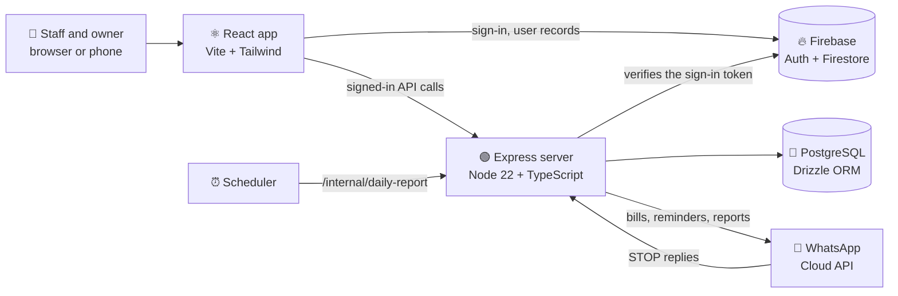

<div align="center">


# ERP Starter Kit

**A complete, multi-branch ERP base you can fork and turn into your own business software**

Sales · Stock · Invoices · Cash book · Service · Payroll · WhatsApp · Dashboards


[Features](#-whats-included) · [Quick start](#-quick-start) · [**Build your own ERP**](#-build-your-own-erp-step-by-step) · [Architecture](#-architecture) · [Settings](#-settings-environment-variables) · [Deploy](#-deploy) · [Security](#-security)

</div>

---

## 📖 About

This repository is a **base code** for an ERP. It was extracted from a real multi-branch business system, then emptied of every
company detail, key and record. What is left is the working engine: sign-in and roles, branch isolation, billing, stock, cash book,
job cards, payroll, WhatsApp messaging and dashboards, wired together and ready to change.

**You do not get a finished ERP for your business. You get a head start**: fork it, rename it, remove what you do not need,
add what you do, and deploy it as your own.

> ℹ️ The sample data (company, branches, products, customers) is **entirely fictional**. The sample domain is a farm-equipment and
> spare-parts dealer, but the same bones fit any shop, distributor or workshop with branches.

---

## 🧩 What's included

### 🛒 Selling

| | Module | What it does |
|---|---|---|
| ⚡ | **Quick Sale** | Fast counter billing: search by name, SKU or part number, take payment, print or share the bill. |
| 🧾 | **Invoices & Quotations** | Tax and plain invoices, quotations, GST, item lines, payments, amount in words, PDF, public bill link. Two selling companies are supported. |
| 🚜 | **Machine Sales** | High-value items from booking to delivery: payments, dispatch, delivery challan, event trail. |
| ↩️ | **Returns** | Returns against a bill with stock put back and customer credit. |
| 👤 | **Customers** | Customer records, purchase history, ledger, CSV import, search by name or phone. |
| 📞 | **Follow-ups** | Pending calls and reminders. |

### 📦 Stock

| | Module | What it does |
|---|---|---|
| 🏷️ | **Inventory** | Products, categories, minimum stock, prices, per branch and warehouse, CSV import. |
| 🔄 | **Transfers & Ledger** | Move stock between branches and warehouses; full stock ledger and movements; goods receipts and adjustments. |
| 📚 | **Spare Books** | Browse a parts catalogue by book and part number. |
| 🛡️ | **Warranty** | Warranty records with expiry alerts. |
| 🔧 | **Service Job Cards** | Workshop jobs with parts, services, payments and status. |

### 💰 Money and people

| | Module | What it does |
|---|---|---|
| 📒 | **Ledger & Cash Book** | Cash book, day book, customer ledger, expenses, cash and bank, profit and loss, day-end close. |
| 🗃️ | **Business Desk** | An owner's working screen: today, money owed, supplier payments, cash in hand, cash check, buy list, rankings. |
| 💵 | **Payroll** | Salary runs, advances and payslips from attendance. |
| 🗓️ | **Attendance & Staff** | Daily attendance, roster and directory. |
| 📈 | **Insights & Predictions** | Reports, a sales forecast, a seasonal demand calendar and weather signals. |
| 📝 | **Activity log** | Who did what and when; append-only. |

### 💬 WhatsApp (optional, needs your own Meta account)

Bill messages · purchase thank-yous · reminders with a cooldown · bulk marketing to a group · **opt-out handling** (a customer who
replies STOP is never messaged again, with Meta's signature checked) · an evening **daily report**.

### 🔐 Platform

Firebase sign-in with admin approval · 11 roles · **server-enforced branch isolation** · rate limits · security headers · installable
web app (PWA with offline page) · owner-only SQL backup download · TypeScript end to end.

---

## ⚡ Quick start

> **Needs:** Node 22+, a PostgreSQL database, and a free Firebase project. The full walk-through is in
> [Build your own ERP](#-build-your-own-erp-step-by-step).

```bash
git clone https://github.com/<you>/<your-fork>.git my-erp
cd my-erp
npm install
cp .env.example .env            # then fill in your database values
npm run dev                     # http://localhost:3000
```

---

## 🛠️ Build your own ERP, step by step

### Step 1 · 🍴 Fork and clone

Click **Fork** on GitHub (or **Use this template** if enabled), then:

```bash
git clone https://github.com/<you>/<your-fork>.git my-erp
cd my-erp
npm install
```

Work on your own branch and keep your fork **private** if it will hold your business details.

### Step 2 · 🔥 Create a Firebase project (sign-in and a few records)

1. Go to the [Firebase console](https://console.firebase.google.com) and create a project.
2. **Authentication → Sign-in method**: turn on *Email/Password* (and *Google* if you want it).
3. **Firestore Database**: create a database (production mode).
4. **Project settings → Your apps → Web app**: register a web app and copy its config.
5. Put those values in `firebase-applet-config.json` (the file ships with placeholders).
6. Deploy the security rules: `npx firebase-tools deploy --only firestore:rules,storage --project your-firebase-project-id` (rules are in `firestore.rules`
   and `storage.rules`).

> ✅ A Firebase *web* config is meant to be public. **Never** commit a service-account key.

### Step 3 · 🐘 Create the PostgreSQL database

Any PostgreSQL 14+ works (local, Docker, Cloud SQL, Neon, Supabase ...).

```sql
CREATE DATABASE erp;
```

Put the connection values in `.env` (copy from `.env.example`):

```
SQL_HOST=127.0.0.1
SQL_USER=postgres
SQL_PASSWORD=your-password
SQL_DB_NAME=erp
SQL_ADMIN_USER=postgres
SQL_ADMIN_PASSWORD=your-password
```

Create the tables from the schema files in `src/db/schema*.ts`:

```bash
npm run db:push
```

A few smaller tables (settings, activity log, returns, queues) create themselves on first use.

### Step 4 · 🔑 Start the app

```bash
npm run dev
```

Open <http://localhost:3000>. For local work only you can add `DEV_AUTH_BYPASS=1` to `.env` to skip sign-in checks on your own
machine. It is refused in production.

To fill an **empty** database with the fictional sample data once, set `SEED_SAMPLE_DATA=1` (or call the owner-only
`POST /api/db/init`). Remove the setting afterwards.

### Step 5 · 👑 Make yourself the first Super Admin

New sign-ups are created **unapproved** with the lowest role, by design. Promote your own account once by hand:

1. Sign up in the app with your email.
2. In the Firebase console open **Firestore → `users` → your user document**.
3. Set `approved` to `true` and `role` to `Super Admin`.
4. Reload the app. From now on approve everyone else from the **Access Requests** screen.

Roles: Super Admin, Business Owner, Branch Manager, Branch Person, Accountant, Sales Manager, Salesperson, Purchase Manager,
Warehouse Manager, Warehouse Staff, Cashier. Who sees which screen is in `src/utils/access.ts`, and the server enforces the same
lists.

### Step 6 · 🎨 Make it yours (rebrand)

| Change | Where |
|---|---|
| App name, tab title, description | `index.html`, `public/manifest.webmanifest` |
| Logo and app icons | `public/icons/` (192, 512, maskable, favicon, Apple touch) |
| Company name, GSTIN, bank, prefixes | `src/data/mockData.ts` (`initialCompanySettings`), then the in-app **Control Center** |
| Selling companies (invoice letterheads) | `src/db/companyService.ts` (`DEFAULTS`), ids `main` and `second` |
| Sidebar title | `src/components/layout/Sidebar.tsx` |
| Home state for GST (intra vs inter state) | `SELLER_STATE` in `src/components/documents/calc.ts` |
| Currency and date format | `initialCompanySettings` in `src/data/mockData.ts` |
| Product categories and customer segments | the `ProductCategory` and `CustomerSegment` types in `src/types/erp.ts` |
| Sample data | `src/data/mockData.ts`: replace, or empty the arrays |
| Seasonal demand calendar | `src/db/farmingCalendar.ts` is **example data**; replace it with your region or delete the Predictions tab |
| Subsidy reference | `src/data/subsidyData.ts` is **example data** from public sources; replace or remove |

### Step 7 · ✂️ Remove what you don't need

Each module is a vertical slice, so it can be cut out cleanly. To remove one (for example **Machine Sales**):

1. Delete its view in `src/components/views/` and its folder if it has one (`src/components/machine-sales/`).
2. Remove its `lazy` import and `case` in `src/App.tsx`, and its entry in the two menu lists in `src/components/layout/Sidebar.tsx`
   (one list is for branch users, one for owners).
3. Delete its route file in `src/routes/` and its `register...Routes(app)` line in `server.ts`.
4. Delete its service in `src/db/` and API client in `src/services/`.
5. Run `npm run lint`. The type checker lists every leftover reference.

### Step 8 · ➕ Add your own module (worked example: "Gate Pass")

Every module follows the same six touch points. Here is the whole path:

**1. Table** · `src/db/schema.gatePasses.ts` (Drizzle picks up every `schema.*.ts` file)

```ts
import { index, pgTable, text, timestamp } from 'drizzle-orm/pg-core';

export const gatePasses = pgTable(
  'gate_passes',
  {
    id: text('id').primaryKey(),
    branchId: text('branch_id').notNull(),
    vehicleNo: text('vehicle_no').notNull(),
    note: text('note'),
    createdBy: text('created_by'),
    createdAt: timestamp('created_at').defaultNow().notNull()
  },
  (t) => [index('idx_gate_passes_branch').on(t.branchId)]
);
```

Then run `npm run db:push`.

**2. Service** · `src/db/gatePassService.ts` (all SQL lives here)

```ts
import { desc, eq } from 'drizzle-orm';
import { db } from './index.ts';
import { gatePasses } from './schema.gatePasses.ts';
import { newId } from '../routes/context.ts';

export const listGatePasses = (branchId: string) =>
  db.select().from(gatePasses).where(branchId === 'all' ? undefined : eq(gatePasses.branchId, branchId)).orderBy(desc(gatePasses.createdAt));

export async function createGatePass(input: { branchId: string; vehicleNo: string; note?: string; createdBy?: string }) {
  const row = { id: newId('gp'), ...input };
  await db.insert(gatePasses).values(row);
  return row;
}
```

**3. Route** · `src/routes/gatePassRoutes.ts` (always take the branch from the verified user, never from the request body)

```ts
import type { Express, Request, Response } from 'express';
import { getAuthContext, scopedBranch } from './context.ts';
import { createGatePass, listGatePasses } from '../db/gatePassService.ts';

export function registerGatePassRoutes(app: Express): void {
  app.get('/api/gate-passes', async (req: Request, res: Response) => {
    res.json(await listGatePasses(scopedBranch(req)));        // non-owners are pinned to their own branch
  });

  app.post('/api/gate-passes', async (req: Request, res: Response) => {
    const { branchId } = getAuthContext(req);
    const vehicleNo = String(req.body?.vehicleNo || '').trim();
    if (!vehicleNo) return res.status(400).json({ error: 'Vehicle number is required.' });
    res.json(await createGatePass({ branchId, vehicleNo, note: req.body?.note, createdBy: req.auth?.email }));
  });
}
```

Register it in `server.ts` next to the others: `registerGatePassRoutes(app);` (every `/api` route is already behind sign-in).

**4. Client** · `src/services/gatePassApi.ts`

```ts
import { apiRequest, type ApiScope } from './apiClient';

export const gatePassApi = {
  list: (scope: ApiScope) => apiRequest<any[]>('/gate-passes', scope),
  create: (scope: ApiScope, body: { vehicleNo: string; note?: string }) =>
    apiRequest<any>('/gate-passes', scope, { method: 'POST', body })
};
```

**5. Screen** · `src/components/views/GatePassView.tsx`: a normal React component that calls `gatePassApi` (copy `ReturnsView.tsx`
or any small view for the table, form and styling).

**6. Menu** · add `'gate-pass'` to the `ViewType` union in `src/types/erp.ts`, a `lazy` import and a `case 'gate-pass'` in
`src/App.tsx`, and an entry in the menu lists in `src/components/layout/Sidebar.tsx`. To limit who sees it, add a helper in
`src/utils/access.ts` and check the same role list in the route.

Run `npm run lint`, then `npm run dev`.

### Step 9 · 💬 Connect WhatsApp (optional)

Follow [`docs/WHATSAPP-BULK.md`](docs/WHATSAPP-BULK.md): create a Meta app, a phone number and message templates, then set the
`WHATSAPP_*` values in `.env`. Without them the app still works and offers a "send manually" link instead.

### Step 10 · 🚀 Deploy

See [Deploy](#-deploy). Set `NODE_ENV=production` and keep `AUTH_MODE=enforce`.

### Step 11 · ✅ Before you go live

- [ ] `firebase-applet-config.json` holds **your** Firebase project
- [ ] No `.env`, keys or service-account files are committed (`git status`, `git log -p | grep -i key`)
- [ ] Sample data removed (`SEED_SAMPLE_DATA` unset) and your own company details entered
- [ ] You are the only Super Admin; everyone else approved with the lowest role they need
- [ ] Database backups turned on at your host, and a restore tested once (see [`docs/DATA-PROTECTION.md`](docs/DATA-PROTECTION.md))
- [ ] `npm run lint`, `npm run test:cash`, `npm run test:optouts` and `npm run build` pass

---

## 🏗️ Architecture



| Layer | Folder | Notes |
|---|---|---|
| Screens | `src/components/views/` | One per menu item |
| State | `src/context/` | Sign-in state and ERP data |
| API clients | `src/services/` | One per area, all through `apiClient.ts` |
| Routes | `src/routes/` | One file per area; all `/api` calls need a verified sign-in |
| Services | `src/db/` | All SQL and business rules |
| Tables | `src/db/schema*.ts` | Drizzle schema, one file per area |
| Security | `src/auth/` | Token verification, rate limits, headers |

---

## 🗂️ Project layout

```
server.ts                  Express server: security, core API, static files
src/
  App.tsx, main.tsx        App shell
  auth/                    Request verification, rate limits, security headers
  routes/                  API routes, one file per area
  db/                      Drizzle schemas and services (one per area), WhatsApp senders
  services/                Front-end API clients
  context/                 Auth and ERP state
  components/              views/, dashboard/, desk/, ledger/, documents/, machine-sales/, staff/, voice/, layout/
  data/                    Fictional sample data, subsidy reference
  utils/access.ts          Who may see which screen
tests/                     Cash book and opt-out tests
docs/                      WhatsApp setup, data protection
firestore.rules, storage.rules, firebase.json    Firebase configuration
Dockerfile                 Container build
```

---

## ⚙️ Settings (environment variables)

Copy `.env.example` to `.env`. **Never commit `.env`.**

| | Setting | Purpose |
|---|---|---|
| 🐘 | `SQL_HOST` `SQL_USER` `SQL_PASSWORD` `SQL_DB_NAME` | PostgreSQL connection (required) |
| 🛠️ | `SQL_ADMIN_USER` `SQL_ADMIN_PASSWORD` | Only for `npm run db:push` |
| 🔒 | `AUTH_MODE` | `enforce` rejects unverified API calls (the default in production) |
| 🧪 | `DEV_AUTH_BYPASS` | `1` skips sign-in for local requests only; refused in production |
| 🌱 | `SEED_SAMPLE_DATA` | `1` fills an empty database with the fictional sample data |
| 🌐 | `PORT`, `PUBLIC_BASE_URL` | Server port and the public address used in bill links |
| 💬 | `WHATSAPP_*` | Meta Cloud API token, phone number id, template names, webhook token and app secret |
| 🗝️ | `DAILY_REPORT_KEY` | Secret your scheduler sends to `/internal/daily-report` |
| 🤖 | `ANTHROPIC_API_KEY`, `VOICE_MODEL` | Optional: the Tamil voice-entry helper (off by default in the UI) |
| ☁️ | `CLOUD_SQL_INSTANCE`, `GOOGLE_CLOUD_PROJECT` | Optional: shows Cloud SQL backup status on the desk screen |

---

## 🧪 Scripts

| Command | What it does |
|---|---|
| `npm run dev` | Start the server and the web app together |
| `npm run build` | Production build into `dist/` |
| `npm start` | Run the server (serves `dist/` in production) |
| `npm run lint` | TypeScript type check |
| `npm run db:push` | Create or update tables from the Drizzle schema |
| `npm run test:cash` | Cash book and handover maths |
| `npm run test:optouts` | STOP handling and webhook signature |

---

## 🚀 Deploy

The `Dockerfile` builds the app and starts the server, so it runs anywhere that runs a container or Node 22.

```bash
docker build -t my-erp .
docker run -p 3000:3000 --env-file .env -e NODE_ENV=production my-erp
```

Google Cloud Run, Fly.io, Railway, Render and a plain VPS all work. Keep secrets in your host's secret store, point `SQL_HOST` at
your database, and set `PUBLIC_BASE_URL` to your real address.

---

## 🔒 Security

- 🔑 Every `/api` call needs a verified Firebase sign-in; in production an unverified call is refused even if a setting is missing.
- 🏬 Roles and branch scope are checked **on the server**, not only hidden in the UI.
- 🚦 Rate limits on the API, public bill pages, webhooks and internal calls.
- 🧱 Security headers on every response; database errors are hidden from users.
- ✍️ The WhatsApp webhook verifies Meta's signature on the exact request body.
- 📝 Firestore rules keep the activity log append-only and stop users choosing their own role.
- 🗝️ `.env`, keys and service-account files are git-ignored.

> 🐞 Found a vulnerability? Please open a private security advisory on the repository instead of a public issue.

---

## 🤝 Contributing

Issues and pull requests are welcome. Run `npm run lint`, `npm run test:cash`, `npm run test:optouts` and `npm run build` before
sending a change, and never include real customer data, keys or company details in an issue or pull request.

---

## 📄 License

[MIT](LICENSE): free for personal and commercial use. The sample data, names and numbers are fictional.

<div align="center">

Built to be forked ⭐ If it saves you time, star the repository.

</div>
